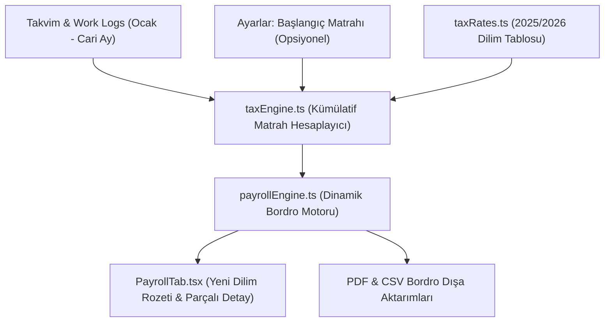

# Dinamik Kümülatif Vergi Matrahı Motoru & Mevzuat Entegrasyon Planı

## 1. Yönetici Özeti ve Mevzuat Arka Planı

Türkiye Gelir Vergisi Kanunu (GVK Madde 103) gereğince, ücret gelirleri üzerinden kesilen Gelir Vergisi **artan oranlı (progresif / kümülatif)** bir sisteme tabidir. Çalışanın her ay elde ettiği net vergi matrahı (`Brüt Kazanç - %14 SGK İşçi Payı - %1 İşsizlik Primi`), yılın başından itibaren biriktirilir (**Kümülatif Gelir Vergisi Matrahı**).

Mevcut durumda Vardiyo'da bu hesaplama sabit ilk dilim olan **%15** üzerinden varsayımsal yapılmakta ve bordro altında kullanıcıya *"Hesaplamalar sabit ilk vergi dilimi üzerinden yapılmaktadır..."* şeklinde bir feragat metni gösterilmektedir. 

Bu plan ile sistem;
1. **Gelir Vergisi Dilimleri (2025/2026)** sınırlarını ve dilim geçişlerini (dilim atlama anındaki parçalı hesaplama),
2. **Asgari Ücret Vergi İstisnası (GVK 23/18)** kümülatif istisna mahsubunu,
3. **Takvim & Puantaj Kayıtlarından Otomatik Kümülasyonu** (Ocak ayından cari aya kadar),
4. **Yıl Ortası / Farklı İşyeri Başlangıç Matrahı Desteğini** (Kullanıcı dilerse kümülatif matrahını manuel girebilir),
eksiksiz ve yasal kurallara %100 uyumlu olarak hayata geçirecektir.

---

## 2. Yasal Hesaplama Mantığı ve Matematiksel Model

### 2.1 Gelir Vergisi Dilimleri ve Oranları (Ücret Gelirleri İçin)
```text
Dilim 1:  0 TL          -  158.000 TL       ->  %15
Dilim 2:  158.000 TL    -  380.000 TL       ->  %20
Dilim 3:  380.000 TL    -  1.400.000 TL     ->  %27 (Ücretliler için özel tarife)
Dilim 4:  1.400.000 TL  -  4.300.000 TL     ->  %35
Dilim 5:  4.300.000 TL üzeri               ->  %40
```

### 2.2 Aylık Matrah ve Kümülatif Geçiş Formülü
Bir $m$ ayı için:
1. **Aylık Vergi Matrahı ($M_m$):**
   $$M_m = \text{Toplam Brüt Hakediş} - \text{SGK Kesintisi (\%14)} - \text{İşsizlik Fonu (\%1)}$$
2. **Önceki Aylardan Devreden Kümülatif Matrah ($K_{m-1}$):**
   $$K_{m-1} = \text{Başlangıç Matrahı (varsa)} + \sum_{i=1}^{m-1} M_i$$
3. **Ay Sonu Kümülatif Matrah ($K_m$):**
   $$K_m = K_{m-1} + M_m$$
4. **Dilim Geçişli Vergi Hesabı ($GV_{\text{brüt}}$):**
   - $K_{m-1}$ ve $K_m$ aralığı vergi dilim sınırlarını kesiyorsa dilim parçalarına ayrılır:
   $$GV_{\text{brüt}} = \text{Vergi}(K_m) - \text{Vergi}(K_{m-1})$$
   Burada $\text{Vergi}(x)$, 0'dan $x$'e kadar olan kümülatif tutarın dilimlere göre toplam vergisidir.

### 2.3 Asgari Ücret Gelir Vergisi İstisnası (Kümülatif Mahsup)
Asgari ücretli bir çalışanın o aydaki kümülatif matrahına göre ödeyeceği gelir vergisi tutarı istisna kabul edilir ve çalışanın vergisinden düşülür:
$$GV_{\text{ödenecek}} = \max\Big(0, GV_{\text{brüt}} - \text{Asgari Ücret GV İstisnası}(m)\Big)$$

---

## 3. Mimari Tasarım ve Değişiklik Adımları



### Adım 1: Sabitler & Dilim Tanımları (`src/constants/taxRates.ts`)
- Gelir vergisi dilim sınırları dizi formatında tanımlanır:
  ```typescript
  export interface TaxBracket {
    limit: number; // Üst sınır (örn: 158000)
    rate: number;  // Vergi oranı (örn: 0.15)
  }
  export const TAX_BRACKETS_2026: TaxBracket[] = [
    { limit: 158000, rate: 0.15 },
    { limit: 380000, rate: 0.20 },
    { limit: 1400000, rate: 0.27 },
    { limit: 4300000, rate: 0.35 },
    { limit: Infinity, rate: 0.40 }
  ];
  ```
- Asgari ücret aylık kümülatif GV istisna tablosu eklenir (Ocak-Aralık aylarında asgari ücretin dilim atlamasına göre değişen resmi istisna rakamları).

### Adım 2: Çekirdek Vergi Motoru (`src/core/taxEngine.ts`)
- `calculateCumulativeTax({ previousCumulativeBase, currentMonthBase, year, month })` fonksiyonu yazılır.
- Fonksiyon şu çıktıları üretir:
  - `taxRaw`: İstisna öncesi hesaplanan brüt gelir vergisi
  - `exemption`: O aya ait asgari ücret GV istisnası
  - `taxFinal`: İstisna düşüldükten sonra maaştan kesilecek net vergi
  - `effectiveRate`: Efektif vergi oranı (örn: %17.4 - dilim geçişinde)
  - `activeBracket`: Baskın veya ulaşılan vergi dilimi (örn: %20)
  - `bracketBreakdown`: Dilim geçiş detayı (Örn: "45.000 ₺ x %15 = 6.750 ₺, 15.000 ₺ x %20 = 3.000 ₺")

### Adım 3: Bordro Motoruna Entegrasyon (`src/core/payrollEngine.ts`)
- `generatePayrollData` fonksiyonuna kümülatif matrah parametresi (`cumulativeTaxBaseBeforeMonth: number`) bağlanır.
- Eğer parametre verilmemişse veya 0 ise, yılın önceki aylarındaki loglardan veya kullanıcının ayarlarındaki `starting_tax_base` değerinden hesaplanır.
- Bordro veri nesnesine (`payrollData`) şu alanlar eklenir:
  - `taxBase`: Bu ayın matrahı
  - `cumulativeTaxBase`: Bu ay dahil toplam kümülatif matrah
  - `taxBracketLabel`: "%15", "%20", "%15 -> %20 (Geçiş)" vb.
  - `bracketBreakdown`: Parçalı hesaplama dökümü

### Adım 4: Kullanıcı Ayarları & Tipler (`src/types/user.ts`, `src/pages/settings.tsx`, `src/components/settings/PayrollSection.tsx`)
- `UserSettings` arayüzüne 2 opsiyonel alan eklenir:
  - `starting_tax_base?: number;` (Yıl içinde iş değiştiren veya Vardiyo'ya yıl ortasında geçen kullanıcılar için önceki işyerinden devreden kümülatif matrah).
  - `starting_tax_base_month?: number;` (Bu matrahın hangi ay başı itibarıyla geçerli olduğu, örn: 6 = Temmuz).
- Ayarlar ekranında `3. Bordro ve Ek Ödemeler` altına şık bir yardımcı kutucuk eklenir:
  *"Kümülatif Vergi Matrahı Devri (Yıl ortasında işe başladıysanız önceki işyerinizden devreden matrahı girebilirsiniz)."*

### Adım 5: Arayüz & UX Yenilemesi (`src/components/calculations/PayrollTab.tsx`)
- Eski *"Hesaplamalar sabit ilk vergi dilimi üzerinden yapılmaktadır..."* uyarı/feragat metni **tamamen kaldırılır**.
- Yerine modern, güven veren ve şeffaf bir **Vergi Dilimi Kartı / Rozeti** konulur:
  - Rozet: `🎯 %20 Vergi Dilimi (Kümülatif Matrah: 215.450,00 ₺)`
  - Dilim Atlama Uyarısı: Eğer o ay dilim geçişi olduysa:
    *"💡 Bu ay kümülatif matrahınız 158.000 ₺ sınırını aştığı için gelirinizin bir kısmı %15, aşan kısmı %20 diliminden vergilendirilmiştir."*
  - Yasal Kesintiler tablosunda Gelir Vergisi satırına tıklanınca veya yanında açılır detayda dilim dökümü gösterilir.

### Adım 6: SSS, Metinler ve Dokümantasyon (`src/constants/faqData.ts`, `ROADMAP.md`, `GEMINI.md`)
- `src/constants/faqData.ts`: Vergi dilimleri ile ilgili soru ve cevaplar güncellenerek Vardiyo'nun kümülatif matrahı ay bazında otomatik takip ettiği gururla vurgulanır.
- `ROADMAP.md` ve `GEMINI.md`: Phase 10 backlog'undaki madde tamamlandı olarak işaretlenir.

---

## 4. Test ve Doğrulama Senaryoları

| Senaryo | Aylık Brüt | Ay / Kümülatif | Beklenen Sonuç |
|---|---|---|---|
| **1. Asgari Ücretli (Net 22.104 ₺)** | 26.005 ₺ | Ocak - Aralık | Yıl boyunca sıfır vergi (istisna tam karşılar) |
| **2. Standart Ücretli (45.000 ₺ Brüt)** | 45.000 ₺ ($M_m \approx 38.250$ ₺) | 1-4. Ay (%15), 5. Ayda 158.000 ₺ aşılır (%20'ye geçiş) | 5. ayda kısmi %15 + kısmi %20 uygulanmalı |
| **3. Yüksek Maaşlı (120.000 ₺ Brüt)** | 120.000 ₺ ($M_m \approx 102.000$ ₺) | 2. ayda %20'ye, 4. ayda %27'ye geçer | Dilim geçişleri tam kuruşu kuruşuna tutmalı |
| **4. Yıl Ortasında Gelen Kullanıcı** | 50.000 ₺ Brüt | Temmuzda başlama, devreden 180.000 ₺ girilmiş | Direkt %20 diliminden hesaplama yapmalı |

---

## 5. Uygulama Sırası ve Güvenlik
1. `src/constants/taxRates.ts` genişletilecek.
2. `src/core/taxEngine.ts` oluşturulacak ve deterministik birim mantığı test edilecek.
3. `src/core/payrollEngine.ts` dinamik vergi motoruna bağlanacak.
4. `src/types/user.ts` ve veritabanı ayar alanları güncellenecek.
5. `src/components/settings/PayrollSection.tsx` ve `settings.tsx` alanları eklenecek.
6. `src/components/calculations/PayrollTab.tsx` UI ve bildirim kartları güncellenecek.
7. Dokümantasyon (`GEMINI.md`, `ROADMAP.md`, `faqData.ts`) güncellenecek.
8. `npm run build` ile TypeScript derleme ve paket bütünlüğü doğrulanacak.

